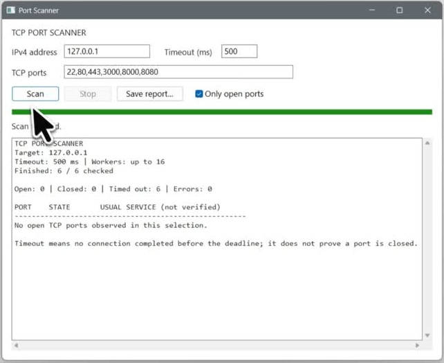

# Port Scanner

A native Windows TCP port scanner built as a C++ cybersecurity portfolio project. Checks a selected set of ports on one IPv4 address.

[](https://github.com/Kredickoa/port-scanner/raw/refs/heads/main/demo/demo.mp4)

[Watch the demo video](https://github.com/Kredickoa/port-scanner/raw/refs/heads/main/demo/demo.mp4)

## Highlights

- Accepts individual ports and ranges, with up to 16 workers and a configurable timeout.
- Includes progress, Stop, an open-port filter and text report export.
- Distinguishes open, closed, timed-out and failed connection attempts.

## Stack

C++17, Windows API, Winsock2, standard-library threads and CMake. No third-party framework.

## Run locally

Requires Windows, CMake 3.16+ and a C++17 compiler. In Visual Studio Developer Command Prompt:

```cmd
cmake -S . -B build
cmake --build build --config Release
build\Release\port-scanner.exe
```

Enter an IPv4 address and ports such as `22,80,443,8000-8010`, then click **Scan**. For a local demo, start `python -m http.server 8000 --bind 127.0.0.1` and scan `127.0.0.1:8000`.

Use on your own devices or systems you have permission to test. A timeout does not prove a port is closed; service names are conventional labels, not verified software identification. IPv4 TCP only.

## Rights

All rights reserved. Shared for portfolio review; reuse requires prior written permission. See [LICENSE](LICENSE).
